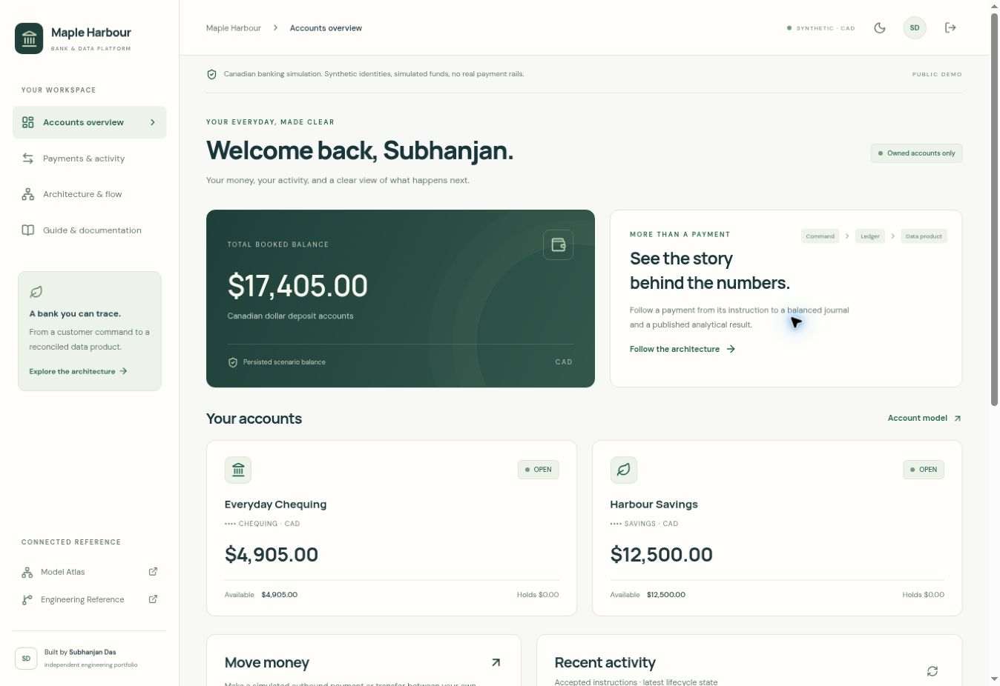
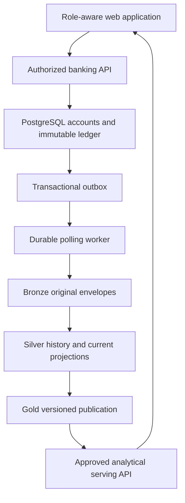

# Maple Harbour Bank

**[Open the live banking app ↗](https://subhanjandas.github.io/maple-harbour-bank/)** · Free public GitHub Pages deployment

**A Canadian banking simulation whose engineering you can trace.**

Built by **Subhanjan Das** · customer and business banking · operations · analytics · engineering · synthetic identities and simulated money.

[Model Atlas ↗](https://subhanjandas.github.io/banking-model-atlas/) · [Engineering Reference ↗](https://subhanjandas.github.io/banking-model-atlas/?page=engineering) · [Current project state](docs/PROJECT_STATE.md)

The live app connects owned CAD accounts, payments, business maker/checker approvals, balanced journals, settlement/partial returns, preserved source events and reconciled analytical publications. Choose Subhanjan, Avery/Morgan, Taylor, Jordan or Casey to explore each workspace.

The public profile runs in a Web Worker and persists each visitor’s isolated simulation in IndexedDB. The separately runnable FastAPI/PostgreSQL profile proves server authorization, database constraints and fault recovery in CI. [Runtime guarantees and trade-offs](docs/PUBLIC_DEMO.md).

**Release 0.3:** 6 public-browser tests, 49 backend tests and 2 server-browser tests passed, along with actual container startup, HTTP payment/return processing and backup/restore. [Exact evidence and tested commit →](docs/TEST_EVIDENCE.md)



[Recorded working demonstration (WebM)](docs/assets/payment-demo.webm) · [Light](docs/assets/customer-light.png) / [Dusk](docs/assets/customer-dusk.png) · [Operations](docs/assets/operations.png) · [Analytics](docs/assets/analytics.png) · [Architecture](docs/assets/architecture.png)

*The image above was captured from the deployed Pages app. [Deployed smoke evidence](evidence/live-pages-verification.json) · [Business banking](docs/assets/public-business.png) · [Public analytics](docs/assets/public-analytics.png) · [Mobile Dusk](docs/assets/public-mobile.png). The recorded WebM and server screenshots demonstrate the independent PostgreSQL lab; [server capture provenance](docs/assets/provenance.json). Kafka/Spark/Delta/Airflow remain planned.*

## Start the core

```bash
python3 scripts/bootstrap.py
docker compose up --build -d
curl --fail http://localhost:8080/api/health/ready
```

For the public zero-cost profile, see [Public demo](docs/PUBLIC_DEMO.md). The server lab is also runnable locally: open **http://localhost:8080**. Choose Subhanjan (customer), Taylor (operations), Jordan (analyst) or Casey (engineer). This selector is a loopback-only **development authentication simulator**; hosted mode disables it and requires OIDC.

1. Subhanjan posts a simulated CAD beneficiary payment; its available balance changes in the same transaction as the ledger and outbox.
2. Taylor acknowledges simulated settlement and records a partial return.
3. The worker archives original envelopes, validates source controls and publishes activity.
4. Jordan sees the publication, source cutoff and freshness. Casey sees actual backlog and run outcomes.
5. Open a payment trace to follow journal → event → archive receipt → ingestion run → publication.

No real customer data or payment rails. This is not a licensed bank, certified compliance implementation or complete production core.

## Public runtime and server lab

| Concern | Live public app | Server lab |
|---|---|---|
| State and processing | IndexedDB + Web Worker in each browser | PostgreSQL + FastAPI + durable worker |
| Identity | Clearly labelled synthetic role simulation | OIDC relying party, trusted sessions, service roles and RLS |
| Persistence | Reload-safe on that device; no cross-device sync | Durable local volume; backup/restore tested in CI |
| Engineering evidence | Actual scenario events, runs and recovery controls | Actual financial concurrency, authorization and subprocess recovery tests |
| Hosting cost | CAD 0, GitHub Pages | CAD 0, local host or bounded public-repository CI |

## Two connected systems · server profile



Spending always uses operational funds protected by database locks. Dashboards use a published analytical version and expose staleness. The architecture explorer and [generated topology](docs/ARCHITECTURE_GENERATED.md) share [one versioned manifest](architecture/manifest.json).

## Engineering claims and boundaries

| Claim | Implemented mechanism | Evidence gate |
|---|---|---|
| No overspending | Canonical account locks; booked minus held funds | Concurrent hot-account test |
| Duplicate command, stable response | Actor/tenant/key lock and stored response | Concurrent duplicate storm |
| Balanced immutable history | Deferred journal constraints, append-only triggers and closed journals | Direct database negative tests |
| Crash recovery | Archive commit before ack; idempotent event identity | Real child-process exits |
| Trustworthy publication | Source identity/checksum controls; atomic serving pointer | Missing-source rejection retains last good |
| No financial snapshot double-count | Versioned history plus latest aggregate projection | Partial returns and late attribution correction |
| Access boundaries | Opaque session, CSRF, scope/ownership and actual DB service roles | Cross-customer/tenant/scope and raw denial tests |

A single host is not high availability. At-least-once delivery is not universal exactly-once processing. See [test evidence](docs/TEST_EVIDENCE.md) for what actually ran.

The measured hot-account command baseline completed three 100-command repetitions at **50.02 / 115.25 / 105.86 accepted commands/s**, zero errors, on a 4-CPU/16GB CI runner. The p99 varied from 483 to 1,168ms. This is a short workload baseline, not maximum sustainable capacity. The separate million-record experiment measures analytical queries, not a million bank transactions. [Raw samples, plans and costs →](docs/PERFORMANCE.md)

## Explore the implementation

- [Architecture](docs/ARCHITECTURE.md) and [trade-offs](docs/DECISIONS.md)
- [Financial semantics](docs/DOMAIN_RULES.md), [contracts](docs/DATA_CONTRACTS.md) and [metrics](docs/METRICS.md)
- [Local setup](docs/LOCAL_SETUP.md), [recovery runbook](docs/OPERATIONS_RUNBOOK.md) and [security](docs/SECURITY_AND_ACCESS.md)
- [Deployment and cost](docs/DEPLOYMENT.md), [performance](docs/PERFORMANCE.md) and [source inventory](docs/SOURCE_CATALOG.md)
- [Interview walkthrough](docs/INTERVIEW_GUIDE.md), [learning notes](docs/LEARNING_NOTES.md) and [Atlas provenance](docs/ATLAS_PROVENANCE.md)

Selected MIT-licensed Atlas definitions and design conventions are reused with provenance. Atlas remains a separate, independently deployable reference. [License](LICENSE).

### Isolated OIDC visitor scenarios

The customer persona is **Subhanjan Das**. A forward migration preserves existing account IDs and ledger history. Invited OIDC users can receive separate customer-only synthetic accounts through the [operator provisioning runbook](docs/VISITOR_SCENARIOS.md), with atomic funding, repeat-request protection, capacity limits, expiry and deactivation. Public hosting and a real deployed identity provider remain pending.

## Public portfolio · zero-cost profile

The public build runs customer banking, business maker/checker approvals, employee operations, analytics, an instrumented recovery lab and architecture explorer. Synthetic scenarios persist in the visitor’s browser. [Runtime guarantees, walkthrough and deployment](docs/PUBLIC_DEMO.md). The original server profile retains OIDC, PostgreSQL and its independent test evidence. [The public app is live](https://subhanjandas.github.io/maple-harbour-bank/), with exact deployment evidence in [project state](docs/PROJECT_STATE.md).
