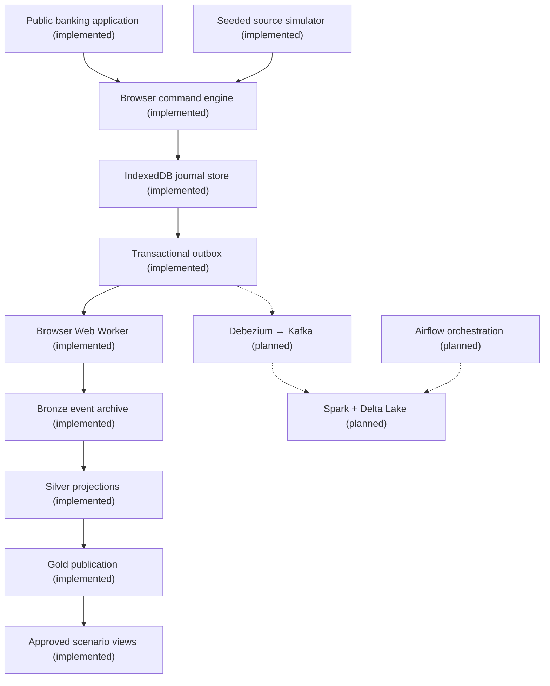

# Architecture generated from the shared manifest

Do not edit the diagram by hand. Run `python scripts/render_architecture.py`.

PUBLIC DEMO · GitHub Pages + browser worker + IndexedDB · no hosted API
