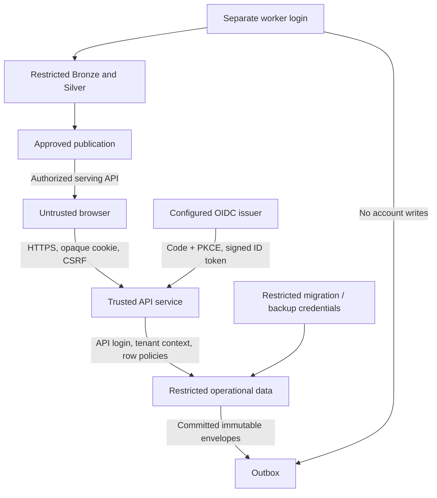

# Security and access

The 21 October dependency audit rejected the candidate because certifi 2026.7.22 was affected by [GHSA-6q48-6c7w-9gw2](https://github.com/certifi/python-certifi/security/advisories/GHSA-6q48-6c7w-9gw2). The transitive lock is updated to 2026.10.19 with registry-provided hashes; CI rebuilds the server image and reruns audit/acceptance. The audit remains enforced.

Release 0.4 public workload start/pause/resume/stop requires the engineer persona in the command adapter; telemetry requires operations, analyst or engineer. The UI also hides staff navigation. These are simulation contracts in visitor-controlled storage, not a trusted public authorization boundary. No remote admin/load endpoint is introduced. Counts, schedule cadence and retained history are bounded. The PostgreSQL/OIDC security profile remains separate and unchanged.

The [live GitHub Pages profile](PUBLIC_DEMO.md) uses isolated browser storage and synthetic role selection. Its role controls demonstrate banking workflows; they are not production authentication against the device owner. The server authorization guarantees below apply to the independently tested FastAPI/PostgreSQL runtime. Public hosting costs CAD 0 and contains no service credentials.

This is a synthetic banking simulation. Controls are implemented and tested at selected boundaries; regulatory certification, production hardening and a complete banking security program are not claimed.

## Trust boundaries

## Implemented controls

- Authlib OIDC authorization code with PKCE, state, nonce and signed ID-token validation. A provisioned `(issuer, subject)` maps to a bank principal; roles/scopes come from the database. No password grant or browser-selected role is trusted.
- Opaque random 30-minute server sessions; only token/CSRF hashes stored. Session cookie is HttpOnly, SameSite Lax, Secure in hosted mode. CSRF header and exact Origin are checked on mutations. Logout revokes the session record.
- Production startup rejects development persona authentication, insecure cookies, non-HTTPS origins or non-HTTPS OIDC issuer. Fixed persona login only exists in development with a configured loopback origin. Compose exposes only its web port on loopback.
- Customer ownership, employee team scope and synthetic tenant checks. Row policies on operational tables fail closed without a transaction-bound tenant. Roles, ledger writes and pipeline access are not only UI restrictions.
- Distinct schema-owner, API and worker database logins. API cannot read raw Bronze or write analytical publications; worker cannot read customer account/session tables or change financial postings. Neither can migrate.
- Parameterized SQL and strict Pydantic command/event contracts. Explicit integer limits, lock/statement timeouts, bounded pool and retry count.
- Durable per-principal request counters (shared across API processes), login limits, same-origin reverse proxy, request body size limit and browser security headers.
- Append-only audit, journal, financial history and source archive. Logs contain normalized route, status, duration and request ID, not token, body, account number or full customer name.
- Local random secrets are generated into ignored mode-600 `.env`; no supplied credentials are committed. Dependency audits and a small tracked-source secret guard run in CI. The latter complements rather than replaces a comprehensive secret scanner.

## Role matrix

| Role | Allowed | Denied |
|---|---|---|
| Customer | Own accounts, beneficiaries, instructions and their traces | Other customers, staff analytics, settlement/return commands, control room, raw data |
| Operations | Payments in assigned scope; simulated settlement/returns; approved aggregate analytics | Different scope/tenant, customer spending commands, engineering controls/raw data |
| Analyst | Published tenant aggregates | Customer command/detail APIs, raw archive, operations and backfills |
| Engineer | Tenant publication/run metadata, outbox backlog and approved aggregates | Customer spending, settlement/returns, raw payload query, unrestricted browser backfill/reset |
| Operator CLI | Explicit migrate, seed, worker, backup/restore or backfill credential | No claim that a filesystem owner or schema administrator is constrained by application policies |

Business organization membership and maker/checker separation are not implemented. Synthetic tenant isolation is tested, but must not be described as business-banking approval enforcement.

## Threat model

| Threat | Control / tested boundary | Remaining requirement |
|---|---|---|
| Customer guesses another payment/account ID | Ownership+tenant filters; 404 outside visibility | Broader ID enumeration/rate-abuse testing |
| Forged role or customer identity | Identity from database session, not request body | Real provider deployment/provisioning process |
| Session theft/CSRF | HttpOnly/Secure/SameSite, exact Origin, CSRF, expiry and revocation | Idle expiry, device/session UI, MFA, provider back-channel logout |
| Concurrent overspending / duplicate storm | Locked funds and key; actual concurrent tests | Multi-node sustained load and capacity limits |
| Employee overreach | Scope checks in command and detail/list APIs | Segregation of duties, privileged-access review and case-assignment policy |
| Analytical/raw leakage | Separate DB grants, no raw browser endpoint | Hosted IAM, encrypted backups, network policy, managed secrets |
| Public abuse of reset/load/failure injection | No such browser endpoints; local selector disabled hosted | Per-visitor scenario isolation before public release; edge protection |
| Supply-chain or secret leakage | Lockfiles, package audits, small source guard | Digest-pinned images, action SHA pinning, comprehensive scanning and signing |
| Database administrator rewrites evidence | Service roles cannot mutate posted records | Off-host immutable audit/archive and independent operational controls |

OIDC integration tests use a real local HTTP code exchange and signed tokens from a **test provider**, including wrong issuer/audience/nonce/signature/expiry. They do not certify a deployed Keycloak/Entra configuration.

## Public release gate

The authenticated PostgreSQL server profile has no persistent public deployment. Before hosting that backend: isolate each visitor's synthetic scenario; complete a real provider integration and session lifecycle review; configure TLS and secret storage; verify network and service credentials; run backup/restore; bound retention and load; and obtain a paid-resource ceiling if hosting incurs charges. Do not expose the local persona selector or engineering CLI credentials to public visitors.

Forward migration 005 also restricts the API to tenant-scoped outbox **metadata**. It has no SELECT permission on original source envelopes/checksums, although it inserts them as part of the command. The trusted worker alone reads the full source contract for processing; its UPDATE grant is restricted to acknowledgement/retry columns.

## Visitor admission and analytical defence · release 0.2

[Operator visitor provisioning](VISITOR_SCENARIOS.md) creates one customer-only tenant per verified OIDC subject with bounded capacity and lifetime. Role/tenant claims from even a valid signed token cannot override the database assignment. Expired/disabled visitors cannot obtain a new session or use an old one; deactivation explicitly revokes sessions. Public enrollment, staff role creation and reset endpoints are absent. Deactivation takes effect on subsequent authorization checks; in-flight commands may complete.

Migration 008 adds tenant RLS to publications, serving pointers, pipeline runs and quarantine. The lineage metadata view also filters by the bound tenant. Worker processing remains cross-tenant by explicit policy; API raw-table access remains denied. This closes the earlier reliance on endpoint filters alone for approved analytical data. It does not make a fully compromised API role harmless: tenant selection is trusted application code.
